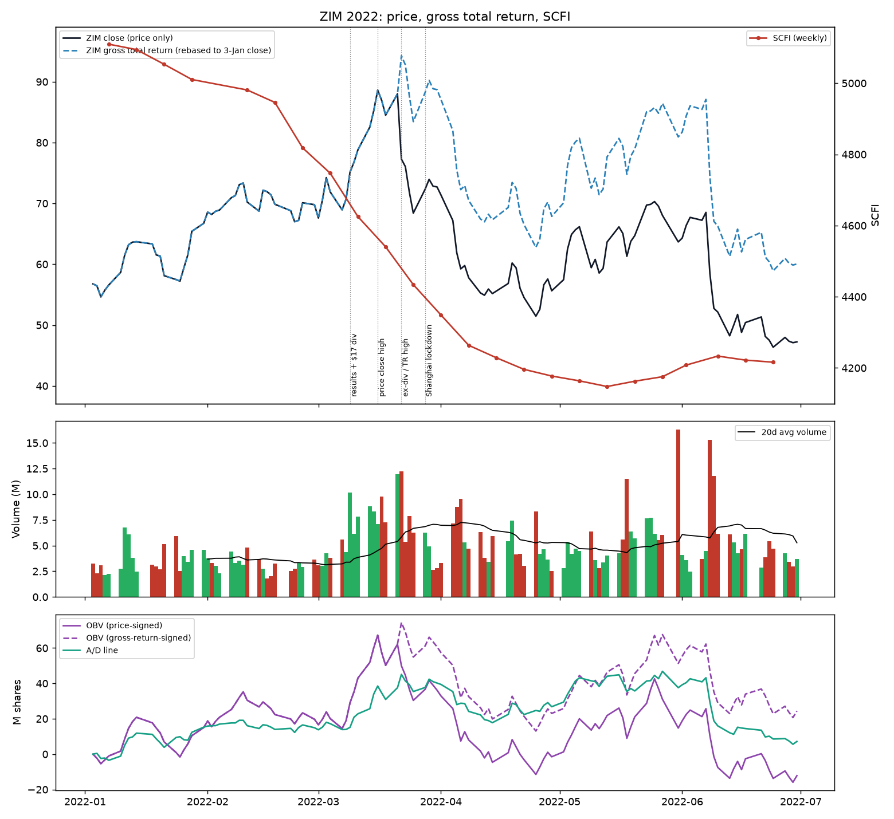
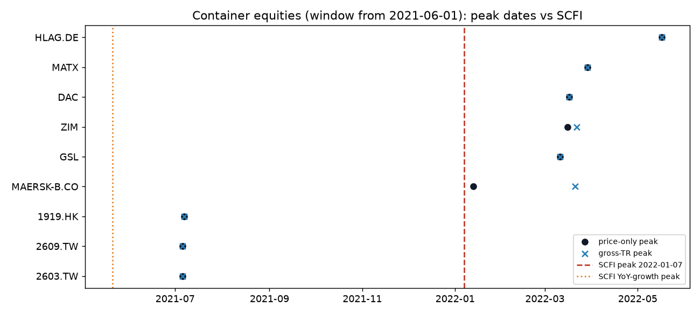
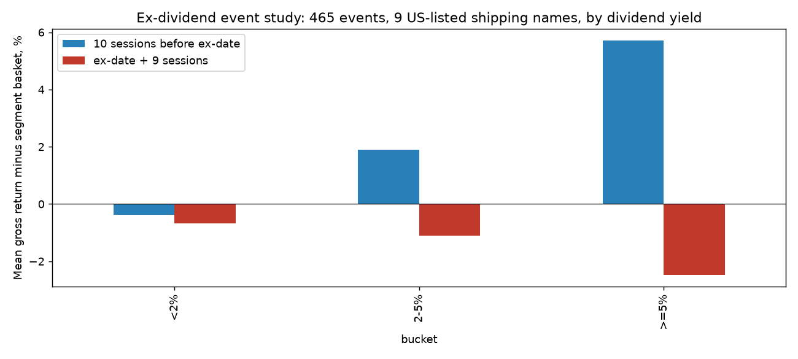

# 🔎 ZIM 2022年3月见顶——量能结构、分红机制、运价时序与"见顶信号"回测

### 以集运股见顶为模板研究VLCC股价顶部——每条结论均用数据检验

*2026年10月13日 — VLCC分析系列 #42（v2：完全重建；取代此前仅含假设的初稿）*

> **声明**：本报告是41_ZIM_Peak_Day_Marker_EN.md的中文版本，所有数据一致。仅供研究，不构成投资建议。全部数字来自 `zim_peak/run_zim_peak_volume.py`（可复现；输出见 `zim_peak/data/`，图表见 `zim_peak/charts/`）。价格：Yahoo Finance日线（yfinance；`Close`仅做拆股调整）。**本文的总回报（TR）是由价格加分红构建的毛财富指数 W_t = W_{t−1}·(P_t + D_t)/P_{t−1}（未扣预提税）**，*不是*Yahoo的"Adj Close"（后者会高估除息日回报）。一手来源：ZIM公告（2022-03-09、2022-03-23）、FINRA合并空头仓位API、上海航运交易所SCFI（两份独立GitHub副本，除2012年3周外完全一致）、Drewry WCI（Drewry原文经worldports.org / airfreight.news转载）。样本为人工选定的14只上市航运股，属样本内研究；未纳入已退市公司（可能存在幸存者偏差）。

---

## 第一步——研究草稿（先给核心结论）

**核心结论。** ZIM的顶部不是"3/31单日+8%"。它是一个六个交易日的价格高点区间（2022年3月14–21日）。**总回报高点记录在$17除息日（3/22）**。这一切发生在**SCFI运价指数见顶10周之后、SCFI连续9周下跌期间**。成交量在业绩/分红窗口明显放大，但**并非**天量。我回测了2004–2026年的8个量价"见顶信号"，与状态匹配的对照相比，均未显示预测提升。**这里没有经过验证的提前预警信号**。可迁移的是结构性经验（运价与股价背离、分红时点），不是交易触发器。

**支持论点（论断 → 所需证据）**

1. *运价见顶后股价仍在上涨* → SCFI周度序列与股价顶部日期。**已具备：** SCFI于2022-01-07见顶，至3/18连续9/9周下跌（−11.1%）。9只集运股中有6只在SCFI见顶后9–19周才创窗口高点（§4）。
2. *按总回报口径，ZIM顶部是一个分红事件* → 毛TR序列＋除息研究。**已具备：** 除息日毛回报+7.12%，TR高点在3/22。在26个派息航运股顶部中，有8个毛TR高点落在除息日当天或其后5个交易日内，日历位移对照约为1.5个（描述性，§5）。
3. *量能只能事后讲故事* → RVOL/OBV/派发日指标＋回测。**已具备：** 3/9–3/22的10个交易日中有9个RVOL≥1.5；按价格方向计的上涨/下跌成交量比从顶部前25日的2.14翻转为其后25日的0.40。但加入量能条件的信号并不优于不含量能的同类交易日（§3、§6）。

**反对论点（论断 → 所需证据）**

1. *一致预期与指引的落差可能导致见顶* → 截至2022-03-08的FY22 EBITDA一手一致预期。**未知**（未获取）。市场反应（3/9 +6.3%，RVOL 3.0）不支持"立即失望"，但不能排除。
2. *VLCC需求刚性、订单量小，集运模板未必适用* → 多个周期的VLCC运价/股价序列。**部分未知：** 仓库中没有TD3C/BDTI日度历史；BWET已隔离（§7）。

---

## 0. 前提核对

| 假设 | 数据 |
|---|---|
| 2022-03-31见顶 | **价格收盘高点$88.62在3/16；盘中高点$91.23在3/17；毛TR高点在3/22（除息日）。** 3/31收$72.71（−0.2%），成交量在734个交易日中排第409 |
| 顶部当日"上涨8%" | 顶部附近没有+8%的*价格*日。**一种可能的对应：** Yahoo式复权图上3/22显示**+8.83%**。当日毛TR为+7.12%，原始价格变动为−12.19%。3/22也是TR高点所在日。无法确认用户实际看的图 |
| 从约$100 | 从未超过$91.23 |
| 跌至约$6 | **2023-11-28收盘$6.59、盘中$6.39。** 较收盘高点价格−92.6%；**毛TR最大回撤−85.0%**（2022-03-22→2023-11-28） |

---

## 1. 逐日行情，2022年3月9日–4月6日（RVOL＝成交量÷此前20日均量）

| 日期 | 收盘 | 价格涨跌 | 成交量 | RVOL | 量排名（734日中） | 备注 |
|---|---:|---:|---:|---:|---:|---|
| 3/9 | 75.14 | +6.3% | 10.1M | 3.00 | #21 | Q4/FY21业绩、$17分红、FY22指引 |
| 3/10 | 76.77 | +2.2% | 6.2M | 1.66 | | |
| 3/11 | 78.81 | +2.7% | 7.8M | 2.03 | | |
| 3/14 | 82.54 | +4.7% | 8.8M | 2.15 | #30 | 深圳封控（新闻报道日期） |
| 3/15 | 85.24 | +3.3% | 8.3M | 1.94 | | FINRA空头仓位5.56M |
| **3/16** | **88.62** | +4.0% | 7.1M | 1.57 | #60 | **价格收盘高点**；美联储首次加息 |
| **3/17** | 86.95 | −1.9% | 9.8M | 2.07 | #25 | **盘中高点91.23**，开89.30→收86.95 |
| 3/18 | 84.50 | −2.8% | 7.3M | 1.42 | | |
| 3/21 | 88.01 | +4.2% | 12.0M | 2.22 | #12 | 最后含权日 |
| **3/22** | 77.28 | **−12.2%**（毛TR **+7.1%**） | 12.3M | 2.10 | #11 | **除息$17.00；毛TR高点** |
| 3/24–25 | 71.86 / 68.40 | −5.5% / −4.8% | | 1.23 / 0.94 | | |
| 3/28 | 72.34 | +5.8% | 6.3M | 0.92 | #80 | 上海封控（新闻报道日期） |
| 3/31 | 72.71 | −0.2% | 2.8M | **0.40** | #409 | 季末；成交萎缩 |
| 4/4–4/5 | 67.18 / 61.86 | −5.9% / −7.9% | | 1.03 / 1.25 | | 4/4支付$17 |
| 4/6 | 59.23 | −4.3% | 9.5M | 1.32 | | 毛TR首次收于本轮上涨锚定VWAP之下；MOM20触发 |

后续收盘：2022-06-30 $47.23 → 2022-12-30 $17.19 → **2023-11-28 $6.59**。

---

## 2. 顶部前后的已核实事实

| 项目 | 数值 | 来源/状态 |
|---|---|---|
| Q4-21 / FY21净利润 | $17.1亿（每股$14.17）/ $46.5亿（每股$39.02） | ZIM公告2022-03-09 ✅ |
| FY21调整后EBITDA | $65.97亿，FY20为$10.36亿（**+537%**） | ZIM公告表格 ✅ |
| FY22指引 | 调整后EBITDA $71–75亿（**+7.6%至+13.6%**），调整后EBIT $56–60亿 | ZIM公告 ✅ |
| 分红 | 每股$17.00（约$20.4亿，隐含约1.20亿股）。$17＋Q3中期$2.50＝$19.50≈FY21净利润的50%；另有2021年9月特别股息$2.00 | ZIM公告 ✅ |
| 日期 | 除息3/22，登记3/23，支付4/4 | ZIM公告 ✅ |
| 预提税 | 以色列预提税：一般25%，大股东30%；依以色列税务局裁定可适用较低税率 | ZIM公告2022-03-23 ✅ |
| 除息跌幅比 | （3/21收盘−3/22开盘）/$17＝**0.82**；收盘口径0.63。预提税可能影响除息定价；这些观测无法识别其贡献 | 计算 |
| 业绩公布后的市场反应 | 3/9 +6.3%（RVOL 3.00），3/10 +2.2%（RVOL 1.66） | 计算 |
| 3/9前FY22 EBITDA一致预期 | **未知。** 搜索引擎给出的分析师下调说法无法溯源，未采用 | — |
| 空头仓位（FINRA，结算日） | 2/28 5.01M（约1.20亿总股本的4.2%）→ **3/15 5.56M（4.6%），回补天数1.0** → 3/31 3.79M → 6/30 9.16M（7.6%）→ 12/30 17.74M（14.8%，回补天数5.1） | FINRA API ✅ |

**空头仓位。** 3/15报告的空头仓位约为1.20亿总股本的4.6%（自由流通股未知）。这些观测**不能**证明发生了轧空。净空头仓位在3/31前下降，随后在下跌过程中大幅上升。*（初稿中"高空头占比/轧空"的说法撤回。）*

---

## 3. 量能结构——量能显示了什么、没显示什么

| 指标 | 读数 | 解读（描述性） |
|---|---|---|
| 上涨段2021-12-20（$50.67）→3/16（$88.62），59个交易日+74.9% | **截至3/16共11个交易日RVOL≥1.5**：1月4个（1/11、1/12、1/21、1/24），之后为3/7、3/9–3/11、3/14–3/16 | 放量集中在业绩/分红窗口，而非贯穿整段上涨 |
| 3/9→3/22 | **10日中9日**RVOL≥1.5（除3/18外）；10日全部≥1.4 | 业绩→顶部→除息期间连续10日放量 |
| 换手率3/14–3/21（6个交易日） | **约1.20亿总股本的44.4%**（自由流通股未知，按流通股计会更高） | 顶部换手极高 |
| 顶部日成交量规模 | 734日中排名#11–#60（前1.5–8.2%） | 异常偏高，但**成交量最大的10天都出现在之后**（2022年5月–2023年12月），其中7天为下跌日，如2022-06-08 −14.7%、2023-05-22 −16.2% |
| 上涨/下跌成交量比（按价格方向） | 顶部前25日**2.14**→其后25日**0.40**→其后50日0.81 | 之前为正向量能失衡，之后为负向。只有在知道顶部后才看得出 |
| OBV（按价格方向） | **3/16与价格同步创新高**→至3/31减少31.1M，至4/29减少68.8M | **价格顶部处无OBV看跌背离** |
| OBV（按毛回报方向） | 最高点在3/22（除息日计为上涨日） | 结论相同；高点随回报口径变化 |
| A/D线（按CLV加权） | 3/16创新高；序列最高点在2022-05-27 | 顶部无背离 |
| 派发日（近25日中放量下跌≥0.2%） | 顶部时6个；4/21达到最多9个 | 派发集中出现在顶部*之后* |
| 自12/20低点锚定的VWAP（毛TR） | 首次收于其下为**4/6**（价格顶部后15个交易日） | 趋势破位确认较晚 |
| 相对表现3/16→3/31 | SPY毛TR +4.0%；ZIM毛TR **+0.1%**；ZIM价格−18.0% | 按总回报计，ZIM走平，同期大盘上涨 |

**结论。** 量能对顶部的描述*事后*很清楚：业绩、顶部、除息期间换手激增，随后转为卖出主导。但在顶部当时，OBV和A/D是确认价格而非背离。最大成交量出现在数月后的下跌日。§6检验这类形态在一般情况下能否预测顶部。

---

## 4. 运价与股价顶部

**SCFI（上海航运交易所，周度）：**

- 2022-01-07见顶**5,109.60**。至3/18**连续9/9周下跌**（4,540.31，−11.1%）。
- 首次较峰值低≥5%：2/25（4,818.47）；首次低≥10%：3/18。
- 后续读数：3/25 4,434.07 → 6/30 4,216.13 → 12/30 1,107.55 → 2023-03-31 923.78。
- SCFI同比增速在2021-05-21见顶（+305%）。

**Drewry WCI：** 2021年9月峰值$10,377/FEU → 2022-03-17 $8,832.23（−14.9%）→ 3/31 $8,152.09。

**股价顶部，窗口自2021-06-01起（距SCFI峰值周数；价格｜毛TR）：**

| 公司 | 价格高点日期 | 滞后（价格） | 滞后（毛TR） |
|---|---|---:|---:|
| ZIM | 2022-03-16 | +9.7 | +10.6 |
| GSL | 2022-03-11 | +9.0 | +9.0 |
| DAC | 2022-03-17 | +9.9 | +9.9 |
| MATX | 2022-03-29 | +11.6 | +11.6 |
| 赫伯罗特 | 2022-05-17 | +18.6 | +18.6 |
| 马士基-B | 2022-01-13 | **+0.9** | +10.4（TR高点3/21） |
| 长荣2603.TW | 2021-07-06 | −26.4 | −26.4 |
| 阳明2609.TW | 2021-07-06 | −26.4 | −26.4 |
| 中远海控1919.HK | 2021-07-07 | −26.3 | −26.3 |

**解读。** 在这一个选定周期中，见顶时间**并不一致**：SCFI的水平峰值并非一律领先股价顶部。

- 在2021年6月–2022年12月的搜索窗口内，三家亚洲航运公司的最高点在2021年7月，约在SCFI同比增速见顶后7周。
- 若窗口从2021年10月起，它们在2022年3/4–3/14出现次高点。按纯价格口径，**9家中有7家的窗口高点落在2022年3/4–3/29之间**。
- 马士基的价格高点（1/13）几乎与SCFI峰值同时。

唯一稳健的观察是：**多只股票在运价已下跌两个月时仍创出新高**。

---

## 5. 分红机制——事件研究与顶部

### 5a. 除息事件研究

样本为9只美股上市航运股2004–2026年的465个事件。全部数据为毛TR，采用对称的10个交易日窗口，减去同板块同行组合（不含自身）。方括号为95%移动区块自助法区间：6个月区块，跨公司同步抽样。

| 样本 | n | 除息前10个交易日 | 除息日起9个交易日 |
|---|---:|---|---|
| 全部 | 465 | +0.83% [+0.02, +1.75] | −0.95% [−1.83, −0.15] |
| 股息率<2% | 275 | −0.37% [−1.33, +0.53] | −0.68% [−1.81, +0.28] |
| 股息率2–5% | 157 | +1.90% [+0.80, +3.11] | −1.10% [−2.35, +0.10] |
| 股息率≥5% | 33 | +5.71% [+0.45, +10.66] | −2.48% [−5.66, +1.13] |
| **油轮，股息率≥2%** | 167 | **+2.78% [+1.40, +4.42]** | **−1.42% [−2.62, −0.26]** |
| 美股集运，股息率≥2% | 23 | +0.92% [−3.81, +5.04] | −0.75% |
| 有财报日期覆盖 | 422 | +0.75% [−0.14, +1.79] | −0.97% [−1.91, −0.10] |
| …其中窗口内无财报发布 | 82 | +0.59% [−0.79, +2.27] | **−0.01% [−1.52, +1.25]** |
| 有覆盖，股息率≥2% | 161 | +2.25% [+0.67, +4.13] | −1.33% [−2.75, +0.02] |
| …无财报，股息率≥2% | 36 | +2.24% [+0.14, +5.26] | −0.34% [−2.61, +1.97] |

- **与股息率的关系**（含公司与年份固定效应的斜率）：除息前斜率为每单位股息率0.42，95%区块区间[−0.17, +1.25]。**未得到证实。**
- **ZIM 3/22**（股息率19.3%），相对美股集运同行：除息前+14.4%，除息后（+9日）+3.1%，20日后−3.0%。含权日与除息日RVOL分别为3.7和3.8。
- **ZIM其他超大额分红**没有重复同样的形态：
  - 2023-04-04（股息率27.3%）：除息前+1.1% / 除息后+12.8%。
  - 2024-12-02（16.6%）：−5.9% / +7.9%。
  - 2025-03-24（17.8%）：−13.2% / −0.4%。

**解读。**

- 本样本中，相对同板块同行的除息前平均回报为正，在油轮中最明显。
- 除息后的负均值在一个规模较小、构成不同的无财报子样本中**没有重现**。这限制了解读：它既不能证明原因是财报，也不能证明效应为零。
- 效应随股息率如何变化，未得到证实。

### 5b. 顶部是否集中在除息日附近？

顶部按客观规则定义：在±252个交易日内为序列最高点，且其后252个交易日内下跌≥40%，前后区间完整。扫描范围为14家公司2004–2026年，得到毛TR顶部49个、价格顶部54个。"持续派息"指前126个交易日内派过息。

| 序列 | 持续派息顶部 | 顶部在除息日**之前**1–5日 | 顶部在除息日当天或**之后**0–5日 |
|---|---:|---:|---:|
| 毛TR | 26 | 0（日历位移均值1.37） | **8**（日历位移均值1.55；3,000次位移抽样中0次≥8） |
| 纯价格 | 27 | 3（1.51；3,000次中633次≥3） | 4（2.03；3,000次中467次） |

毛TR的8个案例：

- ZIM 2022-03-22（第0日）
- 马士基 2022-03-21（第3日）
- 马士基 2015-04-08（第3日）
- MATX 2015-11-06（第3日）
- MATX 2024-11-13（第4日）
- 阳明 2007-10-02（第2日）
- DHT 2011-02-02（第0日）
- TNK 2015-10-20（第4日）

**解读。** 26个选定的毛回报顶部中有8个落在除息日当天或其后5个交易日内，而27个纯价格顶部中只有4个。将各公司派息日历位移6–40个交易日后，重合次数更少。这是描述性对比：它不是经过校准的随机期望，也无法区分分红相关的回报行为（价格跌幅小于股息时，毛回报确实为正）与样本选择效应。

**纯价格顶部未见与除息日的可检测关联**。*（此前"价格在除息前3–4日见顶"的说法不成立。）* 2022年3月的ZIM和马士基，**周期内最大一笔派息正是总回报高点的记录位置**。

---

## 6. "见顶信号"回测（含量能）

**设计：**

- **样本：** 14家公司，2004–2026年，使用毛TR口径的OHLC。
- **结果定义（"命中"）：** 未来126个交易日内，股价先跌至次日收盘价的75%以下，且此前从未高于其110%。
- **跟踪期：** 每个触发点和对照日都有完整的128个交易日跟踪，无右侧截断。
- **去重：** 每个信号、每家公司20个交易日冷却期。
- **对照：** 近高点信号对照52周收盘高点10%以内的交易日；MOM20对照低于90日高点15–25%的交易日（深度匹配）。
- **增量量能检验：** 同一价格形态有/无量能条件对比。
- **区间：** 按日历月联合移动区块自助法，跨公司同步，区块长度6个月和12个月。

| 信号 | 触发次数 | 命中率 | 对照 | 差值，百分点 [95%区间，6个月区块] |
|---|---:|---:|---:|---|
| 52周高点反转，RVOL≥1.3 | 175 | 12.0% | 15.1% | −3.1 [−8.1, +2.5] |
| 同形态，RVOL<1.3 | 208 | 11.5% | 15.1% | −3.5 [−7.8, +1.0] |
| 派发日聚集（25日≥6个） | 439 | 16.2% | 15.1% | +1.1 [−2.7, +5.1] |
| 下跌日聚集（无量能条件） | 702 | 16.8% | 15.1% | +1.7 [−0.6, +4.2] |
| 63日新高且OBV低于其63日高点 | 398 | 12.1% | 15.1% | −3.0 [−6.5, +0.3] |
| 63日新高且OBV同步确认 | 459 | 15.0% | 15.1% | 0.0 [−3.1, +2.9] |
| 跌破50日均线，RVOL≥1.5 | 187 | 16.0% | 15.1% | +1.0 [−5.2, +7.6] |
| 跌破50日均线，RVOL<1.5 | 416 | 15.9% | 15.1% | +0.8 [−2.3, +4.3] |
| 跳空低开≥5%，RVOL≥1.5 | 73 | 12.3% | 15.1% | −2.7 [−9.9, +5.2] |
| 近高点处单日−8% | 131 | 17.6% | 15.1% | +2.5 [−4.7, +10.1] |
| **MOM20**（仓库规则：收盘<90日高点的80%） | 608 | 21.2% | **21.4%（深度匹配）** | **−0.2 [−2.4, +1.9]** |

**增量量能对比**（同一价格形态，有量能条件减去无量能条件）：

| 对比 | 差值，百分点 [95%区间] |
|---|---|
| 高点反转 | +0.5 [−5.3, +6.7] |
| 派发聚集 vs 普通下跌聚集 | −0.6 [−4.0, +2.5] |
| 跌破50日均线 | +0.2 [−5.6, +6.2] |
| 跳空低开 | −9.4 [−24.9, +5.9] |
| OBV背离 vs OBV确认（两种OBV状态，并非有/无量能检验） | −3.0 [−6.4, +0.6] |

**稳健性拆分。** 剔除ZIM、仅油轮、2004–2015、2016–2026以及12个月区块，结果相同。约85项对比中，只有2个区间不含零（至少一种区块长度下），且方向都与见顶预警*相反*：

- 油轮中，无放量的反转之后下跌*更少*（−7.4个百分点）。
- 2016–26年，OBV背离之后的下跌比OBV确认*更少*（−4.0个百分点，仅12个月区块）。

这大致符合随机水平。

**ZIM本身：**

- F5放量反转在3/17触发（正确的一天），但也在2/11触发，比价格高点早22个交易日。
- 派发聚集在12/8、2/18、3/7触发。
- MOM20在2021-12-14触发（误报），随后于**2022-04-06在$59.23**触发：较3/22毛TR高点−23.4%，之后股价继续跌至$6.59。

**解读。**

- 这些预先设定的规则，与状态匹配的对照相比，**未显示**对该结果定义的预测提升。
- 加入量能条件未明显改变命中率。
- 这是"未显示优势"，而不是证明量能不含信息。
- 尚未检验：可执行策略的收益（重新入场、成本、跳空、分红权益）以及样本外验证。
- **MOM20**是由回撤触发的离场经验规则；与本次深度匹配对照相比，其增量预测优势未得到证实。这对`modeling_stash.md`第5节"4/4正确"的回测结论构成限定。

---

## 7. 对VLCC顶部意味着什么

**来自ZIM模板的经验（描述性，不是交易触发器）：**

1. **关注运价与股价背离。** 2022年，在SCFI连续9周下跌时，欧美上市集运股仍创新高。当实际运价下行而股价仍在创新高时，就处于集运顶部形成的区域。在这一个周期中，股价高点出现在运价峰值后9–19周。这不是时间规律。
2. **创纪录分红影响的是*如何衡量*顶部。** 按正确口径，2022年3月ZIM和马士基的总回报高点记录在本周期最大的除息日。持仓应按毛总回报跟踪，并掌握每个除息日。
3. **油轮的除息前超额表现。** 10个交易日平均相对同行+2.8%（区间不含零）。除息后−1.4%的回吐在全样本中出现，但剔除财报窗口后不稳健。
4. **不要依赖放量反转、OBV背离、派发日或单日−8%等信号判断顶部。** 均未显示优势。在ZIM顶部，OBV是*确认*高点的。

**当前观测（2026-10-13；仅为观测，并非经验证的体系，不构成建议）：**

| | FRO | DHT | INSW |
|---|---|---|---|
| 收盘 | $59.04 | $26.59 | $125.04 |
| 相对52周毛TR收盘高点 | −0.25%（高点10/12） | 处于高点（10/13） | 处于高点（10/13） |
| 最近三次季度股息率 | 3.1%→4.2%→**6.3%**（除息9/18） | 2.5%→3.5%→**6.25%**（除息8/17） | 3.0%→5.5%→4.8%（除息9/10） |
| 近25日上涨/下跌成交量比（按价格方向） | 2.06 | 2.60 | 2.82 |
| 近20日触发的信号 | 反转9/17、9/21；OBV状态不一 | 反转10/5 | 反转9/18 |
| MOM20 | 未触发 | 未触发 | 未触发 |
| 下次财报（yfinance数据商预估） | 11/30 | 10/28 | 11/5 |

- 仓库数据（DHT披露，口径本文未复核）：TCE 2026年Q2 $126.7K/天 → Q3 $94.3K/天。若属实，实际TCE下降而股价处于高点，与ZIM在2022年2–3月的*格局*相同（§4）。一个周期无法说明这种格局会持续多久。
- **BWET已隔离。** 其价格路径（2025年底约$19至现在$999，无拆股记录）需先完成公司行动/净值核验，才能作为运价代理。

---

## 第二步——严格同行评审（针对上方第一步草稿）

**1. 需要核实的事实**

- SCFI/WCI数值来自一手发布的二手副本（两份SCFI副本一致；WCI三月数值来自转载）。深圳/上海封控日期为新闻报道。
- §7的TCE数据来自仓库，本文未复核。
- 财报日期为数据商（yfinance）数据，覆盖不全。自由流通股未知，因此空头仓位与换手率的分母使用总股本。

**2. 逻辑跳跃 / 概念偷换**

- "TR顶部是分红事件"混淆了*高点记录在哪里*（机制）与*投资者为何卖出*（行为）；数据只支持前者。
- "运价领先股价"由一个滞后不一的周期外推得出，且亚洲公司更早见顶。

**3. 遗漏的反例 / 竞争性解释**

- 马士基价格高点几乎与SCFI峰值同时；亚洲航运公司在2021年见顶。
- ZIM此后16–27%股息率的分红并未出现除息前上涨、除息后下跌。
- 宏观因素未被隔离：美联储加息、俄乌战争、2022年3月熊市反弹。
- 一致预期未知。

**4. 最需补充的一手来源**

- 上海航运交易所SCFI档案与Drewry WCI档案。
- 截至2022-03-08的ZIM FY22 EBITDA彭博/LSEG一致预期。
- 自由流通股数据。
- 油轮周期的TD3C/BDTI日度历史。
- 公司确认的财报日期。

**5. 至多只能算推测的句子**

- 行为意义上的"ZIM顶部是分红捕获顶部"。
- "TCE下降而股价在高点，意味着VLCC顶部临近"。
- 任何关于VLCC股价顶部在运价峰值后*多少周*出现的说法。

---

## 8. 对抗性评审记录（规则4b——gpt-6-astra）

**第0轮（初稿，10月13日）：** 10项发现，包括"两周冲顶"措辞、"分红磁铁"因果、事后的"信号1–6"、"−54%总回撤"标签和过拟合的交易规则。均已在中间稿中处理。

**第1轮（本数据研究v1）——"不可发布"：**

| # | 发现 | 结论 | 处理 |
|---|---|---|---|
| 1 | Yahoo Adj Close不是毛TR（除息日+8.83% vs +7.13%） | 错误 | 重建毛TR指数；所有TR数值重算 |
| 2 | 按TR方向计的OBV把除息日计为上涨日；"吸筹"表述过度 | 无支持 | 同时给出价格方向与毛回报方向OBV；改为"正向量能失衡" |
| 3 | "空头不重"；把回补当作轧空买盘的上限 | 无支持 | 采用评审措辞；删除上限推断 |
| 4 | 价格/TR口径混用；"取决于市场"的结论 | 错误 | 一次只用一种口径，三个搜索窗口；改为"时间不一" |
| 5 | 窗口不对称；只用SPY基准；朴素t值；"随股息率递增"未经检验 | 无支持 | 对称窗口、板块基准、固定效应斜率、剔除财报窗口、区块自助法 |
| 6 | 用TR顶部检验价格顶部的论断；对照偏弱 | 错误 | 价格与TR顶部分别检验；区间完整 |
| 7 | MOM20提升度用错了（近高点）基准 | 错误 | 改用深度匹配对照：提升度消失 |
| 8 | "量能信号被否定"表述过度 | 错误 | 增加增量量能对比；改为"未显示优势" |
| 9 | BWET路径未核验；离场建议未经检验 | 无支持 | BWET隔离；删除建议 |
| 10 | 样本选择、样本内、截断、可复现性 | 有效 | 说明样本与局限；强制完整跟踪期；提交数据与代码 |

**第2轮（v2）——"不可原样发布"：**

| # | 发现 | 结论 | 处理 |
|---|---|---|---|
| 1 | 日历位移对照不是经过校准的零假设（移除了同一事件的匹配；未重新模拟入选资格） | 作为显著性检验错误 | 撤回p值，改为描述性对比 |
| 2 | 单月自助法忽略了126日结果之间的重叠 | 无支持 | 跨公司同步移动区块自助法（3/6/12个月区块），联合抽样 |
| 3 | 事件计数不一致（≥2%为189 vs 190） | 错误 | 修正分桶边界（股息率恰为2%）；现为157+33＝167+23＝190 |
| 4 | 上涨段放量计数标注有误 | 错误 | 给出精确日期范围 |
| 5 | 无财报子样本被过度解读 | 无支持 | 全部/有覆盖/无财报分别报告；措辞收窄 |
| 6 | 把预提税作为解释 | 无支持 | 改为"可能影响；无法识别" |
| 7 | MOM20"限亏/不是预测器"表述 | 过度 | 采用评审措辞 |
| 8 | INSW股息率被说成上升；数据商财报日期；FRO高点 | 错误/无支持 | 已更正；日期标为数据商预估；FRO低于10/12收盘高点0.25% |
| 9 | 样本末端处理未说明 | 无支持 | 所有观测要求完整跟踪期；已在§6说明 |

**尚未完成（已声明的局限）：** 除息聚集的正式校准零假设；含重新入场与成本的可执行策略回测；样本外验证；一手一致预期数据。

---

## 9. 数据与可复现性

- **代码：** `zim_peak/run_zim_peak_volume.py`。需要Python 3.12、yfinance、pandas、numpy、scipy、matplotlib。价格在首次运行时缓存；数据获取日期2026-10-13。
- **输出（`zim_peak/data/`）：**
  - `summary.json`（所有核心数字）
  - `zim_daily_yahoo.csv`、`zim_peak_window.csv`
  - `container_peaks_vs_scfi.csv`
  - `exdiv_event_study.csv`
  - `major_tops.csv`
  - `flag_triggers.csv`、`flag_backtest.csv`
  - `finra_short_interest_zim.csv`
  - `scfi_weekly_source{A,B}_*.csv`
  - `earnings_dates_yfinance.csv`
- **样本：** ZIM、MATX、DAC、GSL、赫伯罗特、马士基-B、长荣、阳明、中远海控；FRO、DHT、INSW、TNK、NAT；基准SPY。
