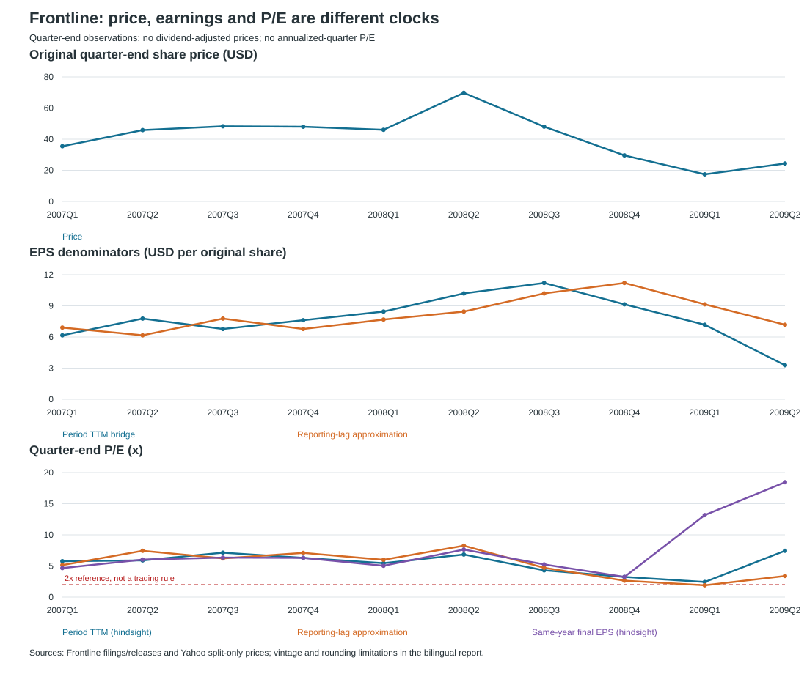

# Frontline 2007Q1-2009Q2: why did P/E reach 2x after the price peak?

**Research date: October 12, 2026**

[中文](fro_2007_2009_cn) | [DHT Q4 fact-check](report_en) | [Research hub](../)

> **Conclusion:** the low P/E followed the price peak because the numerator repriced faster than the backward-looking earnings denominator. Frontline's reconstructed original closing-price high was **$71.76 on June 23, 2008**; the intraday high was **$72.36 on June 24**. At **2008Q2-end**, the period-TTM EPS bridge gives **6.84x**, not 2x. At **2009Q1-end**, the same-period hindsight TTM gives **2.42x**, while using the previously released FY2008 EPS gives **1.90x**.
>
> **The earnings peak depends on the definition:** reported quarterly net income peaked in **2008Q2 at $318.4m**; net income excluding company-identified items peaked in **2008Q1 at $183.9m** within the available comparison; the period-TTM EPS bridge peaked in **2008Q3 at $11.21**. The idea that "earnings always peak after the stock" is therefore too broad.
>
> **The crisis mattered, but Lehman was not the first turning point.** Frontline's August report already described a late-July tanker-market deterioration. The broader financial crisis had begun earlier, and the autumn recession/credit shock intensified the downturn. Oil-demand weakness, OPEC cuts, ton-mile contraction, new tonnage and floating storage all matter; their separate causal contributions are not identified.

## Scope and evidence boundary

This extends the earlier P/E fact-check with a reproducible quarterly dataset, a reconstructed original-price series and an explicit reporting-lag comparison. **The latter is an approximation, not a fully versioned information-available backtest.** Some original release pages were unavailable during this research. Downloaded reports, company-release reproductions, indexed announcement details, reconstructed cells and unresolved dates are distinguished in the [input data](https://github.com/liqiqiii/VLCC-Analysis-2026/blob/master/dht_q4_2026/data/fro_earnings_2006_2009.json).

No quarterly profit is multiplied by four in the main P/E table. No dividend-adjusted price is used. All historical dollar amounts are nominal, original-share-basis USD; comparing dimensionless P/E does not require claiming that a historical dollar has today's purchasing power. Analysis only, not investment advice.

## Step 1 — Research draft

| Type | Claim → evidence needed | Finding |
|---|---|---|
| Support | Prices must match historical EPS → split-only prices and independent original-price checks | Divide Yahoo `Close` by 5; all ten quarterly high/low ranges reconcile to the annual-report NYSE tables |
| Support | P/E compressed after the price peak → quarter-end prices and explicitly defined trailing earnings | Price fell while trailing earnings initially rose; the different clocks are visible in the table |
| Support | Lehman alone cannot date the start of the turn → contemporaneous company commentary and crisis chronology | August report describes late-July weakness; the broader crisis already existed before September |
| Counter | A reporting-lag series is not automatically exact point-in-time data → complete revision and release-time history | Not fully obtained; approximation and reconstructed EPS cells are disclosed |
| Counter | Reported profit is not pure freight earnings → identified gains, costs, fleet mix and operating rates | Q2's reported profit peak differs from the ex-items peak; no universal lag is inferred |

## 1. Recovering the actual historical price basis

Yahoo's daily `Close` is adjusted for later splits, but is distinct from `AdjClose`, which incorporates distributions. The recorded corporate action is a **1-for-5 reverse split effective February 3, 2016 on the NYSE** [H5]. For this historical sample:

```text
Original historical price = vendor split-only Close / 5
```

Dividends are **not** subtracted again or added back to obtain an actual historical quoted price. The ex-distribution price was the price investors could trade. Cash and in-kind distributions matter to shareholder total return, which is a different calculation. In particular, the 2007 Ship Finance distribution means vendor dividend events must not all be assumed to be ordinary cash dividends.

| Trading date | Vendor split-only Close | Reconstructed original close |
|---|---:|---:|
| 2007-12-31 | $240.00 | $48.00 |
| 2008-06-30 | $348.90 | $69.78 |
| 2008-12-31 | $148.05 | $29.61 |
| 2009-03-31 | $86.95 | $17.39 |

The daily snapshot is rounded to cents after undoing the split. It is cross-checked against **every quarterly high/low range from 2007Q1 through 2009Q2** in Frontline's annual reports [H1-H3]. In particular, the reconstructed **$72.36** high agrees with the original filing, not a modern adjusted chart. The daily date comes from the vendor series; the filing independently confirms the level and quarter, not the precise trading day.

**This is a checked reconstruction, not access to the original exchange tape.** Price falls shown here are not total-return losses after distributions.

## 2. Three P/E definitions, three different questions

| Column | Calculation | What it answers |
|---|---|---|
| Period TTM P/E | Quarter-end price / TTM EPS bridge ending in that quarter | What multiple results after that period's earnings become available? **Hindsight** |
| Reporting-lag P/E | Quarter-end price / approximate EPS bridge available from the preceding results release | What did the trailing screen roughly show then? **Not a full vintage audit** |
| Same-year final P/E | Quarter-end price / that calendar year's final audited basic EPS | How did that price compare with the eventual full-year result? **Hindsight, not a forecast** |

For interim quarters:

```text
TTM EPS bridge = previous full-year EPS
                + current-year cumulative EPS
                - prior-year comparable cumulative EPS
```

At fiscal year-end, use that year's audited annual EPS. This avoids calling four times one exceptional quarter "TTM."

**Important accounting limits:**

- EPS is rounded, and cumulative periods can have different weighted-average share counts. An EPS bridge is an analytical approximation, not a company-reported TTM measure; it need not equal market capitalization divided by exact trailing net income.
- Frontline issued additional shares in 2008. Four quarterly EPS values do not necessarily add to annual EPS: the published rounded 2008 quarterly figures sum to **$9.25**, while audited annual basic EPS is **$9.15**.
- FY2007 preliminary EPS was **$7.68**, versus subsequently audited **$7.62**. The **2008Q1 reporting-lag** column therefore uses **$7.68**. The period-TTM year-end column uses **$7.62**.
- The Q2 2008 report restates comparative Q2 2007 EPS from **$2.53 to $2.51** and H1 EPS from **$4.65 to $4.63**. Original quarterly headline figures and later cumulative comparatives are kept explicitly distinct.
- Prior nine-month 2007 EPS of **$4.94** is reconstructed from the disclosed restated H1 profit and subsequent Q3 correction, not presented as a newly retrieved table cell. The input file explains the derivation.
- The first-public date of Q1 2009 is not resolved beyond **May 28-29**; the report's board date is May 27. That ambiguity does not affect the March/June quarter-end comparison.

## 3. Quarterly P/E timeline

Quarter-end price means the **last trading-day close on or before the calendar quarter-end**. The downloadable [quarterly CSV](https://github.com/liqiqiii/VLCC-Analysis-2026/blob/master/dht_q4_2026/data/fro_quarterly_pe_2007_2009.csv) contains the actual price dates and all denominators.

| Quarter | Original close | EPS: period TTM bridge | Period TTM P/E* | Reporting-lag P/E** | Same-year final P/E* |
|---|---:|---:|---:|---:|---:|
| 2007Q1 | $35.50 | $6.16 | 5.76x | 5.14x | 4.66x |
| 2007Q2 | $45.85 | $7.77 | 5.90x | 7.44x | 6.02x |
| 2007Q3 | $48.28 | $6.77 | 7.13x | 6.21x | 6.34x |
| 2007Q4 | $48.00 | $7.62 | 6.30x | 7.09x | 6.30x |
| 2008Q1 | $46.02 | $8.45 | 5.45x | 5.99x | 5.03x |
| 2008Q2 | $69.78 | $10.20 | 6.84x | 8.26x | 7.63x |
| 2008Q3 | $48.07 | $11.21 | 4.29x | 4.71x | 5.25x |
| 2008Q4 | $29.61 | $9.15 | 3.24x | 2.64x | 3.24x |
| 2009Q1 | $17.39 | $7.18 | 2.42x | 1.90x | 13.17x |
| 2009Q2 | $24.36 | $3.28 | 7.43x | 3.39x | 18.45x |

**\* Hindsight. \*\* Approximate reporting-lag comparison; not an executable historical signal or complete as-of restatement history.**

The same-year final column uses **$7.62 for 2007, $9.15 for 2008, and $1.32 for 2009**. Thus, the **13.17x / 18.45x** entries in 2009 deliberately use a full-year result that was not yet known; they illustrate the danger of valuing the coming year as if the previous year's boom continued.



The chart is quarterly, not a daily trading signal. Its two hindsight series must not be interpreted as information investors possessed at each plotted date.

### Was March 2009 the first 2x observation?

No such first-ever claim was established in the earlier article. The daily extension identifies an earlier example:

```text
February 23, 2009 close $22.34 / Q3-based TTM EPS bridge $11.21 = 1.99x
```

This is the first closing observation at or below 2x in the tested **November 28, 2008-February 25, 2009** subwindow, using the stated approximate denominator. It is **not** a verified first 2x print across all historical P/E definitions. On March 31, the previous full-year EPS was the relevant latest annual anchor: **$17.39 / $9.15 = 1.90x**.

**The useful conclusion is "after the price peak, during the downturn," not "March is a universal magic date."**

## 4. Where did price, profit and freight actually peak?

| Object | Peak in the examined comparison | Timing interpretation |
|---|---|---|
| Original closing share price | $71.76 on 2008-06-23 | Daily vendor reconstruction; original-basis range cross-checked |
| Original intraday share price | $72.36 on 2008-06-24 | Filing confirms the high occurred in Q2 |
| Reported quarterly net income | $318.4m in 2008Q2 | Same quarter as the price peak; public release on 2008-08-21 |
| Net income excluding company-identified items | $183.9m in 2008Q1 | Earlier than the price peak, in the available ex-items comparison |
| Period-TTM EPS bridge | $11.21 in 2008Q3 | Rolling denominator peaked later, incorporating earlier strong quarters |
| Annual reported net income | $698.770m in FY2008 | An aggregate over a year, not a precisely dated economic turning point |
| FRO achieved double-hull VLCC spot TCE | $105,200/day in 2008Q2 | Company quarterly average, not the global daily freight maximum |

### Profit and achieved-rate bridge

| Quarter | Originally announced quarterly net income | Basic quarterly EPS | Net income excluding company-identified items | Achieved double-hull VLCC spot TCE |
|---|---:|---:|---:|---:|
| 2007Q1 | $158.8m | $2.12 | Not compiled | $56,600/day |
| 2007Q2 | $189.1m | $2.53 | Not compiled | $57,700/day |
| 2007Q3 | $24.2m | $0.32 | Not compiled | Not independently tabulated |
| 2007Q4 | $202.3m | $2.70 | Not compiled | $43,600/day |
| 2008Q1 | $221.0m | $2.95 | $183.9m | $104,700/day |
| 2008Q2 | $318.4m | $4.25 | $163.0m | $105,200/day |
| 2008Q3 | $107.8m | $1.39 | $137.1m | $88,600/day |
| 2008Q4 | $51.6m | $0.66 | $79.9m | $59,800/day |
| 2009Q1 | $76.6m | $0.98 | Not standardized | $56,200/day |
| 2009Q2 | $27.8m† | $0.36 | Not standardized | $38,700/day |

**†** The final row's profit is reconstructed from rounded H1 **$104.4m** less Q1 **$76.6m**; the call rounds the quarter to **$28m**. Original quarterly figures do not sum exactly to later audited annual results, especially after 2007 restatements. "Ex-items" follows company-specific adjustments, not a uniform audited recurring-profit definition.

Q2 2008 contained **$155.4m** of identified gains. Excluding these, profit fell from **$183.9m to $163.0m**, even though achieved double-hull VLCC TCE was almost unchanged. The company attributed the decline to fewer on-hire days, drydocking, repairs and fleet effects [H7].

There are consequently **three different lags**:

1. **Voyage/contract-to-revenue lag:** a fixture affects recognized revenue over the voyage or contract, not instantly.
2. **Period-end-to-publication lag:** the Q2 profit peak became public in August, after June's price peak.
3. **Rolling-denominator lag:** TTM remains elevated until old strong quarters leave the window.

The quarterly operating-profit peak need not itself occur after the share-price peak. This sample does not justify a fixed stock-leads-profit rule measured in months.

## 5. Why P/E fell after the top

```text
P/E change factor = price change factor / EPS change factor
```

**First, the price fell while the trailing denominator still rose.** From 2008Q2-end to Q3-end, price fell **31.1%** ($69.78 to $48.07), while the period-TTM EPS bridge rose **9.9%** ($10.20 to $11.21). P/E fell from **6.84x to 4.29x**. This is an arithmetic decomposition, not proof of the market's motives.

**Next, a trailing screen retained boom earnings after the share price had collapsed.** At March 2009-end, the latest annual EPS still contained the exceptional 2008 profits; the price had already fallen to $17.39. A **1.90x** screen did not mean the next year would reproduce $9.15 EPS. FY2009 ultimately produced **$1.32**.

**Then P/E expanded as weak quarters replaced strong ones.** Between 2009Q1-end and Q2-end, price recovered **40.1%**, while the period-TTM EPS bridge fell **54.3%** ($7.18 to $3.28). The period-TTM multiple rose from **2.42x to 7.43x**. A higher P/E here did not simply mean the stock had become more expensive on unchanged earnings.

The stock discounts future cash flows, risk and asset values; trailing P/E uses past accounting income. The combination can be consistent with forward-looking repricing, but this dataset cannot isolate expectations, liquidity, leverage or risk-premium contributions. Dividends and spin-offs also affect the quoted price, so the quoted drawdown must not be presented as a total-return loss.

## 6. Did the financial crisis end the cycle?

**It was an important part of the downturn, but "Lehman alone ended an otherwise intact boom" is not supported.**

| Time | Evidence | Implication |
|---|---|---|
| 2007 to early 2008 | Financial stress emerged in 2007; the US recession began in December 2007; Bear Stearns was rescued in March 2008 [H10] | The financial crisis began before Lehman, so "before September" does not mean "unrelated to the crisis" |
| June 2008 | FRO share-price high; Q2 report later recorded a VLCC orderbook of 208 against a fleet of 486, about 43% [H7] | Supply commitments already existed before the autumn panic |
| Late July / August 2008 | The August report described slower Chinese imports, West African disruption, reduced US oil demand and a Middle East tonnage buildup [H7] | Physical-market weakening was documented before Lehman's September bankruptcy |
| Autumn 2008 | Recession and financial stress intensified; lower oil demand, OPEC cuts and financing pressure accompanied the downturn [H2, H10] | Crisis amplification is supported, but its standalone causal magnitude is not measured |
| Early 2009 | Contango and floating storage absorbed about 45-50 VLCCs, according to the annual report's industry sources [H3] | Floating storage temporarily supported tanker utilization during the crisis |
| 2009 | Company annual report cites oil demand down about 1.5%, tanker ton-miles down about 4.3%, and a steady influx of new tonnage [H3] | Demand, trade distance and effective fleet supply jointly explain pressure |

The August 2008 report is particularly useful because it is **contemporaneous**, rather than a post-crash narrative. The later Q3 company-release reproduction also says fixing short voyages in June/July proved disadvantageous when the market fell at the end of July [H8].

The 2009 annual report's demand and ton-mile figures are estimates attributed to industry/IEA sources, not independently reconstructed measurements. Early-2009 floating storage delayed or cushioned the full impact of weak transport demand; it did not guarantee a sustained earnings boom.

**Counterfactual limit:** this is one historical episode, not a controlled experiment. We cannot establish whether the cycle would have ended at the same time without the crisis, nor assign a percentage of the collapse to Lehman, OPEC, newbuildings or fleet positioning.

## 7. Implications for DHT and the exit discussion

- **Do not use 2x trailing P/E as a target to wait for.** In this episode, it appeared on a depressed price against stale high earnings, not at the share-price high.
- **Do not assume a new financial crisis is required to end a tanker boom.** Cargo volumes, voyage lengths, released capacity and fleet additions can change the balance; the 2008 chronology does not quantify a necessary crisis condition.
- **Do not mistake reporting lag for a fixed economic lag.** Peak quarterly profit, peak adjusted profit and peak TTM are different objects.
- **Track subsequent bookings and new contract economics, alongside price/asset risk.** A high quarterly result can still arrive after the market has begun repricing.

For the October DHT article, approximately 2x **annualized hypothetical Q4** remains different from approximately 2x **backward-looking FRO earnings during a crash**. Neither automatically triggers the earlier staged-exit template. This historical extension does not supply new price targets, calibrated trading thresholds or a forecast date for DHT's peak.

## Step 2 — Strict peer review

### 1. Facts that need verification

Original-basis daily prices are reconstructed and range-checked, not exchange-tape certified. Some original result pages are unavailable; source status and derived EPS cells are recorded. A complete restatement ledger and exact first-public timestamps would be required for a genuine as-of backtest. The global daily tanker-rate peak is not established here.

### 2. Logical leaps / equivocation (concept substitution)

Retrospective period TTM is not available on that quarter's last day. Same-year final PE is not a contemporaneous forward forecast. Ex-items profit is not a standardized recurring measure. A TTM peak after a stock peak does not prove the operating-profit peak occurred later. Price return is not total return.

### 3. Missing counterexamples / competing explanations

Distributions, financial investments, lease accounting, drydocking, equity issuance and changing fleet composition affect the comparison. The ex-items profit peak occurred earlier than the stock peak. Floating storage supported rates during part of the crisis. The observed chronology cannot identify a crisis-free alternative.

### 4. The most important primary sources that should be added

The complete vintage set of all quarterly announcements and revisions; an independent historical daily-price feed on the original share basis; daily broker/Baltic rate histories; dated oil-production, inventory, ton-mile and fleet-delivery series. These would tighten the approximations rather than turn a single episode into a universal timing rule.

### 5. Which sentences can at most be classified as speculation, not fact

"2x always marks the top," "the stock leads operating earnings by a fixed interval," "Lehman was the sole cause," and "the cycle would have continued without the crisis" are unsupported. The reporting-lag series is a disclosed approximation, not a historical trading recommendation.

## Sources, data and reproduction

### GPT-6-Astra adversarial-review record

The completed bilingual study, structured inputs and calculator were reviewed on October 12. No blocking issue was identified for an **approximate historical fact-check**, not an exact as-of P/E series. The following findings were accepted and applied:

| Finding | Verdict | Action |
|---|---|---|
| Single structured release dates overstated certainty for Q3 2008 and Q1 2009 | Correct | Store an unresolved first-public date, a date range and separate board/call/reproduction dates |
| Saying the crisis "created" storage support went beyond the evidence | Correct | Describe storage support during the crisis, without asserting that isolated causal link |
| Tests regenerated artifacts before checking them, potentially hiding stale outputs | Correct | Separate generation from validation; tests compare existing CSV/SVG with calculations without rewriting them |

The review did not independently recreate the unavailable source vintages and did not turn the reporting-lag approximation into a backtest.

| ID | Source | Evidence status / use |
|---|---|---|
| H1 | [Frontline FY2007 annual report](https://www.annualreports.com/HostedData/AnnualReportArchive/f/NYSE_FRO_2007.pdf) | Downloaded original financial tables; FY2006/FY2007 EPS and restated annual accounts |
| H2 | [Frontline FY2008 annual report](https://www.annualreports.com/HostedData/AnnualReportArchive/f/NYSE_FRO_2008.pdf) | Downloaded; printed pages 5-6, 40-41 and 62: accounts, market context, original prices |
| H3 | [Frontline FY2009 annual report](https://www.annualreports.com/HostedData/AnnualReportArchive/f/NYSE_FRO_2009.pdf) | Downloaded; printed pages 6-8, 46-47 and 76: accounts, market context, 2009 price ranges |
| H4 | [Yahoo price snapshot and provenance](https://github.com/liqiqiii/VLCC-Analysis-2026/blob/master/dht_q4_2026/data/fro_price_provenance.json) | Public daily `Close`/high/low and recorded split event; source URLs and fetch date preserved |
| H5 | [Frontline reverse-split announcement](https://www.frontlineplc.cy/fro-results-from-special-general-meeting/) | Company announcement indexed; corroborated with vendor split event |
| H6 | [Original Q2 2007 report](https://hugin.info/182/R/1148282/219291.pdf) | Downloaded; original quarterly and prior-year cumulative EPS |
| H7 | [Original Q2 2008 report](https://hugin.info/182/R/1245151/268811.pdf) | Downloaded; restated comparisons, ex-gains profit, August market outlook |
| H8 | [Q3 2008 company release reproduced by industry press](https://www.shipid.com/news/40267/Frontline_announces_third.html) | Full reproduction; $1.5m prior-year correction, profits, rates, late-July turn |
| H9 | [Original Q1 2009 report](https://hugin.info/182/R/1318078/307659.pdf) | Downloaded; Q1 2009 and Q4 2008 comparisons |
| H10 | [Federal Reserve History: Great Recession and its aftermath](https://www.federalreservehistory.org/essays/great-recession-and-its-aftermath) | Crisis/recession chronology; not a tanker-specific causal estimate |
| H11 | [Q2 2009 earnings-call reproduction](https://www.roic.ai/quote/FRO:NO/transcripts/2009-year/2-quarter) | Rounded profit, EPS, H1 result and achieved rates; transcription errors possible |
| H12 | [Full input/source register](https://github.com/liqiqiii/VLCC-Analysis-2026/blob/master/dht_q4_2026/data/fro_earnings_2006_2009.json) | Additional indexed releases, reconstructed cells, vintage and date limitations |

The original 2006 annual report was also checked against the prior-year annual totals. Full downloaded filings are not republished here; only derived facts, source links and calculations are committed.

```bash
# Rebuild tables and SVG from committed inputs, without network access.
python3 dht_q4_2026/run_fro_history.py

# Validate the price basis, annual-report ranges and denominator calculations.
python3 -m unittest discover -s dht_q4_2026 -p 'test_fro_history.py'

# Optional: replace the public-price snapshot and recheck its split assumptions.
python3 dht_q4_2026/run_fro_history.py --refresh-prices
```

[中文](fro_2007_2009_cn) | [DHT Q4 fact-check](report_en) | [Research hub](../)
